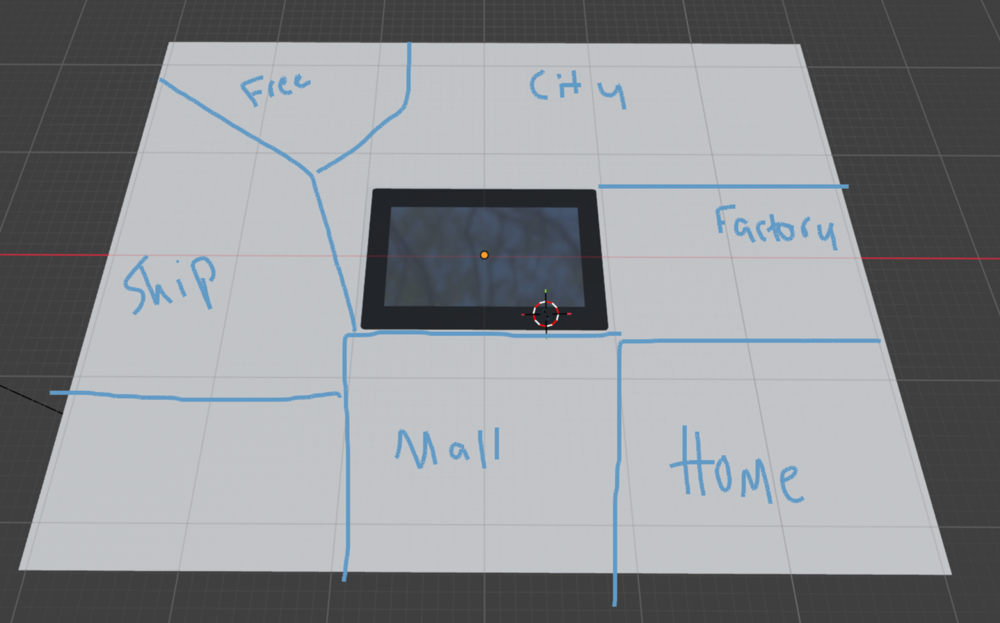
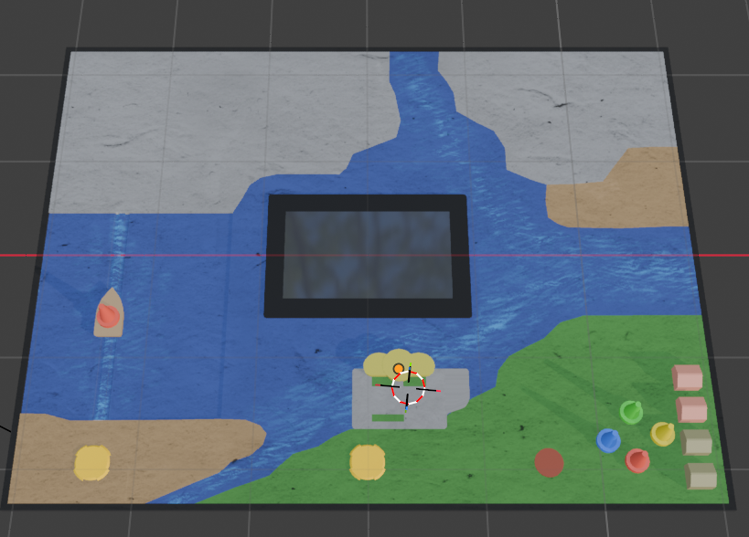
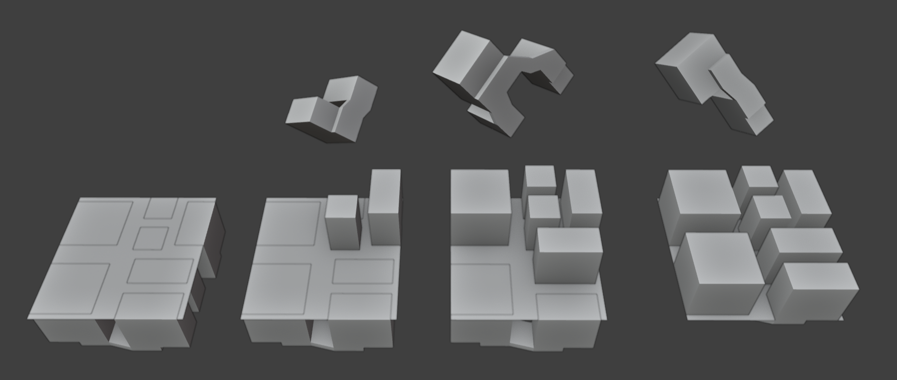
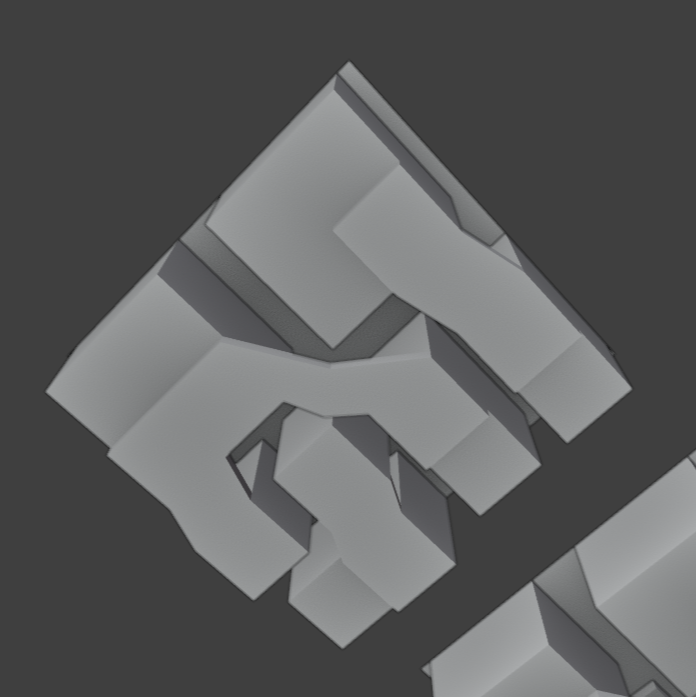

*[Look at it on GitHub so that images are visible.](https://github.com/ratvioli1/tropicamel)*

## Status

I continued the Blender board mockup and worked out a concept for the city.

For the city: three pieces rise in sequence to make unique developmental states. Mockups below:

I'd like to prototype the ship carriage. I'm getting a stepper motor, and going to build one guided city lift before building all of them, since I'd like to know if it's going to work. I've found a 7" screen that I'm sure I can get working, it has its own ESP32 controller so you just send the data over serial. Home, mall, and factory sections still need designs. For the day and night cycle, I'm going to use strip LEDs with printed diffusers. I've ordered player pieces and magnets to insert into them, and hall sensors for the special spaces.

Current card design:

Blender project is also committed.
