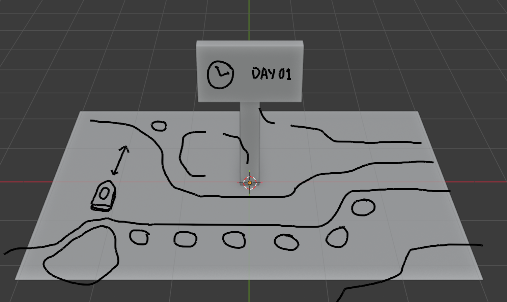

*[Look at it on GitHub so that images are visible.](https://github.com/ratvioli1/tropicamel)*

## Status

This week I wanted to mock the board game's board up a tiny bit.

Some board spaces will sense the player. I'm not sure if I want to do it by weight or with hall effect sensors or something. If I put magnets in player pieces and on the board spaces, it might feel better when moving a piece.

While writing this, I realized that I might want to have like cards or dollars for the game. I'll use Monopoly dollars until a reason not to presents itself. Maybe dice too, but it might be a more fun gimmick to have the unfair randomness selector be something attached to the board itself that you have to interact with, like a crank or a spinner.

And I don't know what player pieces should look like yet, currently I depict them as traffic cones. Banana for scale.

Blender project is also committed.

## Parts

I have one locked-in part, I think.

- [HiLetgo 2.42" SSD1309 128x64 OLED Display Module 2.42 Inch OLED LCD](https://www.amazon.com/gp/product/B0H7TMHRQH)

They have both an I2C and SPI version and from my broken understanding it sounds like driving two I2C displays would be more difficult. Both require soldering though and I've never soldered before. I'll think about it.
